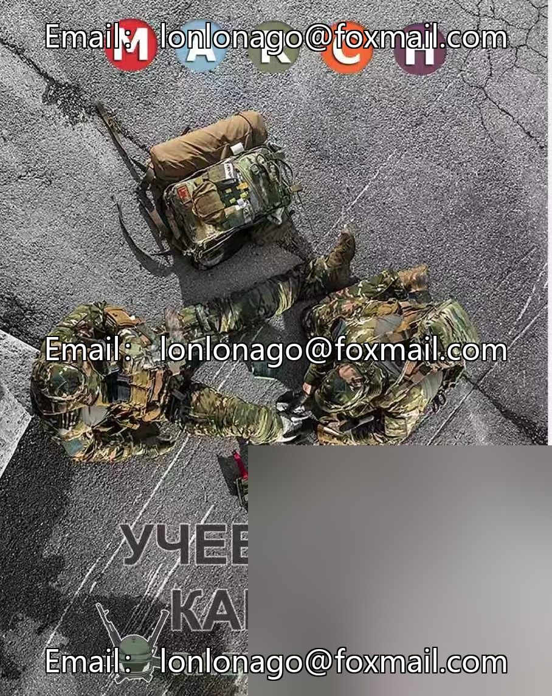
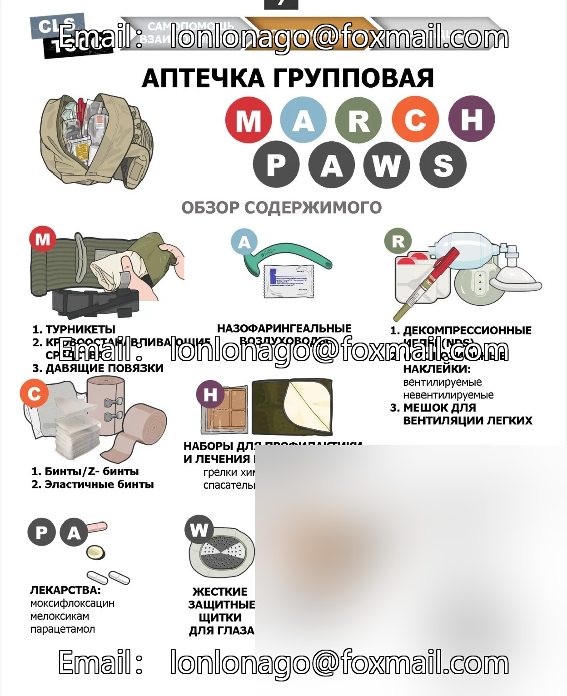
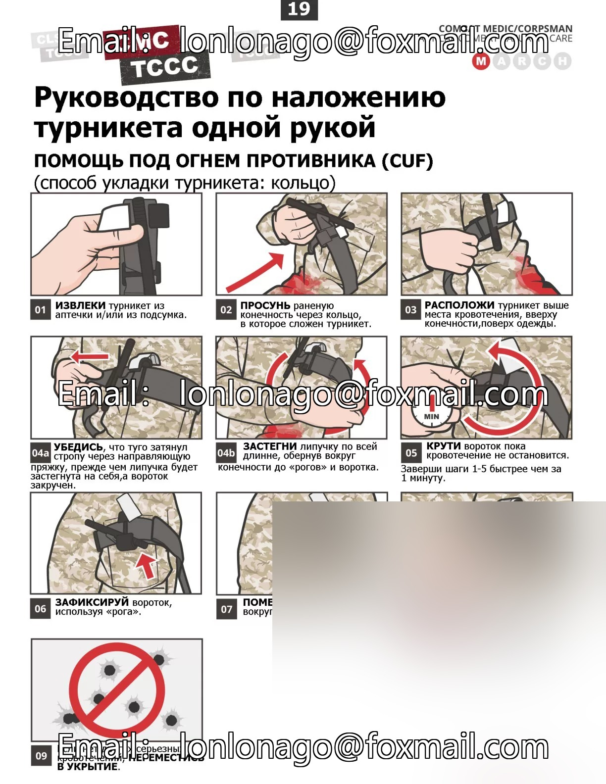
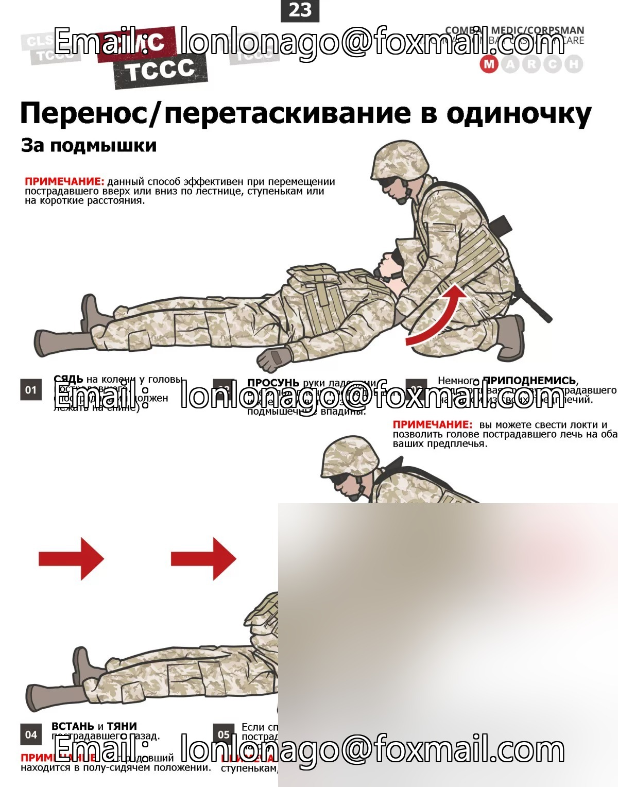
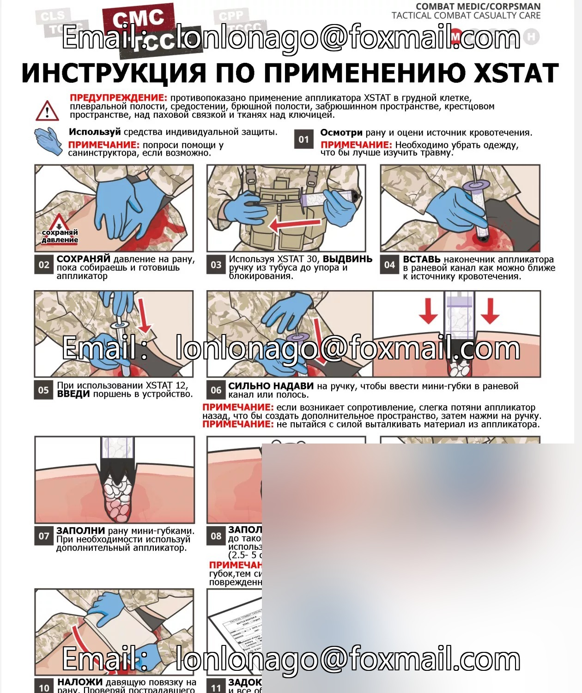
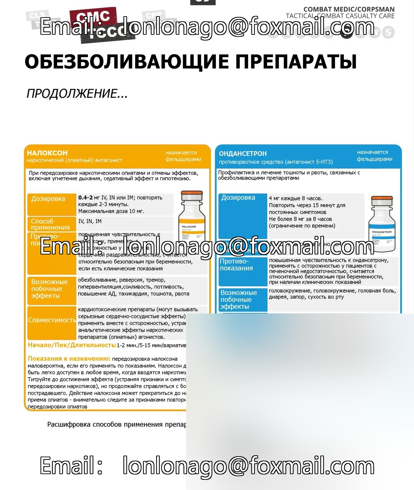

# March Pawes first aid training manual

## Body

MARCH PAWS First Aid Training Manual
MARCH PAWS Small Group First Aid Kit Training Manual, , content covers core skills of TCCC (Trauma Control and Trauma Treatment), suitable for military medical and tactical first aid training.
110 pages
Includes: tourniquets, hemostatic agents, compression packages, nasal ventilation channels, decompression needles, ventilation patches, airbag bags, Z-locks, elastic bandages, anti-freeze and cold first aid, first aid drugs (moxifloxacin, meloxicam, acetaminophen), hard protective goggles, soft bandages, patient cards (DD1380 form), etc., with detailed operation processes and usage instructions.

The materials are in PDF format, with clear content, intuitive operation steps, and are suitable for learning and reference by military personnel, special forces, and tactical medical personnel.

are non-returnable and non-exchangeable upon sale.

The manual covers TCCC core skills and detailed operation procedures for the MARCH PAWS first aid kit, including blood pressure band, pressure pack, medical drugs such as metformin, meloxicam and acetaminophen; it is 110 pages long in PDF format and suitable for troops, special forces and tactical medical personnel.

<!-- AI_ENRICHED -->

## Images

## Payment

Here is a pay link on Stripe ( https://buy.stripe.com/3cs8yP7sY87d0vu9AB ). Please contact me lonlonago@foxmail.com after funding $89, and I will send you a complete data files , thank you!

